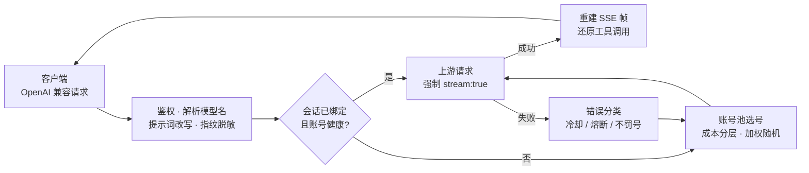

# 网关与选号

本篇说明一个请求进来以后，网关怎么挑账号、怎么改写请求、出错怎么处理。配置项的默认值见[配置](configuration.md)。

- [请求的一生](#请求的一生)
- [选号策略](#选号策略)
- [跨域负载均衡](#跨域负载均衡)
- [会话粘性](#会话粘性)
- [错误分类与账号处置](#错误分类与账号处置)
- [系统提示词与内容审核](#系统提示词与内容审核)
- [推理模型兼容](#推理模型兼容)
- [原生工具调用标记还原](#原生工具调用标记还原)
- [流式输出](#流式输出)

## 请求的一生



1. **鉴权**：`api_key` 非空时校验 `Authorization: Bearer <api_key>`（常量时间比较）。
2. **解析模型名**：`cn:` / `global:` 前缀决定去哪一域选号；不带前缀时默认走国内版，打开跨域负载均衡后两域合池。
3. **改写请求**：按 `prompt.mode` 处理系统提示词，清洗指纹串，补齐推理参数，统一 `developer` 角色、`tool_choice` 与 `image_url` 的写法；历史里配不上对的工具调用、工具名为空的工具调用连同结果一起剔除，免得上游拒收整个请求。
4. **选号**：会话已绑定且账号健康就直接用；新会话先分配一个账号绑定（见[会话粘性](#会话粘性)）；没有会话键、或绑定的账号这次用不了时，从池里挑。
5. **转发**：出站一律 `stream:true`；客户端要非流式时，网关在本地把整段流聚合成一个响应。
6. **出错换号**：按错误类型决定是否惩罚账号，然后换一个账号重试。

## 选号策略

1. **过滤**：去掉禁用、暂停选号、冷却中、熔断中、在途已满的账号；企业号只接自己模型目录里有的模型，企业专属模型只派给目录里有它的企业号（见[企业版模型](tasks.md#禁用暂停与企业版账号)）。
2. **成本分层**：账号对同一个模型的实测扣费可能不同（有的账号有免费额度）。网关按实测把账号分成三层——实测免费、尚无观测、实测收费——只在当前最优的一层里挑。
3. **积分保底**（`pool.credit_floor`，默认关）：余额低于保底值的账号不再接**实测收费**的模型，避免把余额打穿到连免费模型都用不了；免费层和无观测层不受影响。签到回血越过保底值后自动恢复。全池都触底时返回 503，不会放行。
4. **快过期加权**（`pool.prefer_expiring`，默认开）：窗口内（默认 7 天）有积分快过期的账号，权重 ×3。这是软偏好：不按到期先后排序，也和金额无关，弱于会话粘性和成本分层。
5. **加权随机**：`权重 = 积分占比 × 10 + 闲置补偿`。积分占比是该账号积分除以候选里的最大积分；闲置补偿每闲置一小时加 `idle_weight_per_hour`，封顶 `idle_weight_max`，从未用过的账号直接给满。按权重取前 5 个候选再随机。
6. **防惊群**：刚被选中的账号短时间内跳过；全部账号都在冷却时，从软冷却或熔断的账号里挑最早到期的顶上。

**成本探索**（`pool.cost_explore_interval`，默认 30 分钟）：如果免费层一直有号可用，尚无观测的账号就永远学不到真实成本。所以每个窗口会把一个真实请求改道给尚无观测的账号——不额外发请求，成功就完成学习，失败按正常错误处理。

## 跨域负载均衡

默认关闭。关闭时，不带前缀的模型名一律走国内版。打开 `pool.cross_realm` 后，不带前缀的模型名按两个域的模型目录分流：

| 情况 | 去向 |
|---|---|
| 两个域都有这个模型 | 国内版和国际版账号合成一个池，按上面的选号策略挑 |
| 只有一个域有 | 只在那个域选 |
| 两边目录都没有（目录没拉到，或模型名写错） | 走国内版，和关闭时一样 |

补充说明：

- 带前缀的模型名不受影响，想钉死某一域照旧加前缀。
- 模型目录在启动预热和 `/v1/models` 刷新时拉取；某次拉取失败沿用上次成功的目录。
- 积分保底和用量统计里的积分倍率都按实际服务的账号所在域计算（同一模型两域倍率可能不同）；请求日志的模型列写成 `域:模型名`。
- `/v1/models` 会在最前面额外列出不带前缀的名字（两域并集去重，`realms` 字段标出会分到哪些域）。
- 会话粘性同样在合池里分配：新会话可能绑到国际版号，也可能绑到国内版号；已经绑定的会话不因打开开关而换号。关闭开关后，绑在国际版号上的会话下一次请求改回国内版。
- 成本分层是硬过滤，从池里挑号的请求（没有会话键，或绑定的号这次用不了）和新会话的绑定都只在最便宜的一层里挑：某模型在一个域实测免费、另一个域收费时，请求会先全部落到免费那一域，那一域的号都占满或冷却了才轮到另一域。已经绑定的会话不因此换号。
- 需要同时启用国际版（`global.enabled`）。面板「配置 → 账号池与流量治理 → 选号权重」里可以开关，保存即生效。

## 会话粘性

同一会话尽量用同一个账号，多轮对话不跳号：

- **会话键**：依次取 `metadata.conversation_id`、`metadata.conversationId`、顶层 `conversation_id`、顶层 `conversationId`、`prompt_cache_key`。
- **没有会话键时**：用「系统提示词 + 第一条用户消息」的哈希作为会话键，普通 OpenAI 客户端也能享受粘性；请求带了 `metadata.user_id` 时不这样推算。
- **新会话分给哪个号**：先按[成本分层](#选号策略)只留最便宜的一层（含成本探索），再在里面按会话键哈希挑一个，优先还没绑定任何会话的号；这一步不看积分权重。已经绑定的会话照旧用原来的号，免费号出现也不挪走，免得丢掉上游的前缀缓存。打开跨域负载均衡后，可用账号是两个域合在一起的。
- **回到用过的号**：有的模型的前缀缓存按号存（如 `deepseek-v4.1-flash`，见下一条），换到别的号，这一轮要整段重算。网关给每段对话记下最近成功用过的 3 个号（最后一次成功后保留 7 天，和下面的会话 id 一起存盘）。绑定没了要重新分配时（闲置超过有效期、请求失败解绑、网关重启），先回到其中还能用的号，最近用过的优先，不受成本分层限制（同已绑定的会话）；绑定的号这次用不了、要换号重试时，也先试这几个号。都用不了，才按上面的规则挑新号。这个做法参考了 [ardeyouxipianyi/workbuddy2api-hub](https://github.com/ardeyouxipianyi/workbuddy2api-hub)。关闭会话粘性时不记。
- **出站的会话 id（`X-Conversation-ID`）**：官方客户端整段对话都用同一个会话 id。上游的前缀缓存有的模型按号存，有的按会话 id 存：
  - 2026-10-28 在生产国内版实测 `glm-5.3-flash`（前缀约 1 万 token）：同一个会话 id 在原来的号上 4/4 命中，换到别的号上也 4/4 命中；换新 id，同一个号 0/3、别的号 0/9。所以它跟着会话 id 走，不认号。10-27 测出的「要同一个号、同一个会话 id 才命中」是把换号和换 id 放在一起测了，号的那一半不对；同 id 闲置 2、5、10、20 分钟都还命中（10-27 测的）；
  - `deepseek-v4.1-flash` 按号缓存，跟会话 id 无关（10-27：同一个号换新 id 3 次都命中，换号 1 次未命中，样本少）；
  - 2026-10-19 用个人免费号实测：`glm-5.2` 会话 id 稳定时第二轮 8 次全部命中，每轮换新 id 只命中 3/10，未命中的一轮扣 0.63 积分、命中的扣 0.17；`deepseek`、`kimi`、`glm-5.3` 不论会话 id 都能命中；
  - 企业号和付费号没测过。

  客户端在请求体里给了 `conversation_id` 就原样转发。没给时网关按内容认对话，同一段对话的会话 id 不变：
  - 第一轮（历史里还没有助手回复）按「系统提示词 + 第一条用户消息」生成并记下一个会话 id；
  - 出现第一条助手回复后，这段对话接着用第一轮记下的 id，此后不再变。如果这个 id 已经被开头逐字相同、但第一条回复不同的另一段对话用上了，就给这段对话另起一个。所以开头逐字相同的两段对话（比如中转站的渠道测试）第一轮共用一个 id，第二轮起分开。2026-10-19 在两个域用 `deepseek-v4.1-flash`、`glm-5.2`、`glm-5.3`、`kimi-k2.8-preview` 实测过，2026-10-28 又用 `glm-5.3-flash` 测过，同一个会话 id 发不相干的内容不会串会话；
  - 会话 id 的形状同官方新会话：带连字符的 UUID v7，前 48 位是生成时的毫秒数。记录在最后一次使用后保留 7 天，存在数据目录的 `sessions.json`，配置了 Redis 时再镜像一份，网关重启后照旧。以前的版本只在内存里记 2 小时，第二轮、网关重启后都会换 id，上游缓存断一次；
  - 不按号区分：换号重试、换号续聊都用这段对话原来的 id，按会话 id 缓存的模型（如 `glm-5.3-flash`）换了号也接得上缓存；按号缓存的模型换号还是要重算，所以换号时先回到用过的号（见上一条）。1.6.0 的会话 id 是按「号 + 内容」记的，升级后第一次见到升级前开始的对话，接着用它在这个号上的 id；
  - 推算出来的会话键不当作会话 id 发给上游。国际版上游不带这个头会直接拒绝。
- **`prompt_cache_key`**：网关不再自己生成，客户端带了就照转。官方客户端不发它，实测也没有让缓存命中变多（`glm-5.2` 每轮换新会话 id 时带上它反而更差）。
- **上游的对话轮记录**：上游按 `X-Conversation-Request-ID` 把一次用户发言里的所有调用（工具调用续轮、换号重试）记成一轮。客户端给了会话 id 时，按会话 id 和这一轮的用户消息认出这一轮，第一次认出时生成一个记在内存里，保留 2 小时；没给时每次用户发言新生成一个，工具调用续轮凭网关转出去的工具调用 id 找回它，所以开头逐字相同的两段对话也不会并成一轮。形状同官方：去掉连字符的 UUID v7。网关重启时正在进行的那一轮会拆成两条记录。
- **前缀缓存未命中的日志**：网关按对话对照上一轮。这段对话命中过、这一轮大前缀（1000 token 以上）却一点没命中时，记一行 `cache miss`：换了模型、换了号、会话 id 变了、消息比上一轮少（客户端压缩或改写了历史）是预期内的，记 `INFO` 并写明是哪一种；号和会话 id 都没变还是没命中，是上游没留住这段对话的缓存，记 `WARN`，带上距上一轮多久。每段对话 10 分钟内最多记一行；认不出是哪段对话的请求（没有会话键）不判断。
- 绑定有效期默认 30 分钟，每次使用滚动续期；配置了 Redis 时绑定会镜像过去（7 天 TTL），重启不丢。过期或重启后靠「回到用过的号」接上原来的号。
- 请求失败自动解绑；绑定的账号因某个模型限额而不可用时，换模型的请求会重新分配；绑定账号触到积分保底时也会解绑换号。

## 错误分类与账号处置

| 分类 | 触发条件 | 账号处置 | 恢复 |
|---|---|---|---|
| 余额不足 | HTTP 402 / 额度用完的业务码（`14001` `14012` `14013` `14014` `14018` `14019`）/ 余额关键词 | 冷却到**次日 04:00** | 签到或余额刷新发现余额恢复即解冻 |
| 频控 | HTTP 429 / 限流文案 | 软冷却 `soft_rate`，连续触发指数退避，封顶 `soft_rate_max` | 到期自动恢复，成功后清零退避 |
| 模型级限额 | `code 6000`–`6008`（按模型的 token、请求数限额，常见 `6004`） | 冷却到上游给出的重置时间（封顶 `soft_rate_max`）；**换别的模型照样可用** | 到点自动恢复 |
| 模型繁忙 | `code 14003`，以及每秒、每分钟限额 `6001` `6002` `6005` `6006` 没给重置时间时 | **只冷却这个号的这个模型约 30 秒**（上游给了 `Retry-After` 就按它），当场换号重试；所有号都挡住时回 429 + `Retry-After` | 到期自动恢复 |
| 会话太多 | `code 10105`（这个号同时进行的会话太多） | 账号冷却约 60 秒，当场换号重试 | 到期自动恢复 |
| 授权过期、未激活 | `code 14015` `14016` `14017` | 软冷却 `soft_rate` | 到期再试；补完激活后恢复 |
| Session 失效 | `12153` / `Offline user session not found` | **连续 3 次**才禁用（单次多为网络抖动） | 重新登录，或面板「解冻」 |
| 账号被风控 | 403 + `code 11140` + `request illegal`（「账号存在异常行为」） | 禁用这个号，原因里提示去官方申诉；同一个域短时间内多个号被限时**整域暂停**，见下文「风控波暂停」 | 向官方申诉，解除后在面板「解冻」；重新登录一般解不开 |
| 上游 404 | HTTP 404 | 固定冷却 60 秒 | 到期自动恢复 |
| 服务端错误 | HTTP ≥ 500 | 计入连续失败，达阈值熔断 | 熔断到期或成功后清零 |
| 上下文超限 | 400 / 404 / 413 + `code 11115` 或超限文案 | **不罚账号、不换号**（换哪个号都一样），原文返回 | 即时 |
| 请求体解析失败 | 400 + `code 11101` | **不罚账号、不换号**，原文返回 | 即时 |
| 内容拦截 | 400 + `code 11128` 或审核文案 | **不罚账号**，按下一节降级重试 | 即时 |
| 其他客户端错误 | 其余 4xx / 业务码非 0 | 不处罚，换号重试 | 即时 |

业务码的含义和归类照官方客户端（WorkBuddy 桌面端内置的 CLI）的错误码表；业务码比状态码和文案更可靠，先按它判。上下文超限的文案也照官方的词表认，覆盖各家模型供应商的说法。

客户端压缩过的请求体（`Content-Encoding` 为 gzip、deflate、br、zstd，或没标头但内容是 gzip）网关会先解开；解不开或不是合法 JSON 的请求就地回 400，不打上游。

**熔断**：所有冷却入口与 5xx 共用一个连续失败计数，累计达 `breaker_threshold`（默认 3）触发熔断，时长 `breaker_cooldown × 2^次数`，封顶 `breaker_cooldown_max`。成功即清零。

**软冷却退避**：同一账号连续触发软冷却时，冷却时长为 `soft_rate × 2^(连续次数-1)`，封顶 `soft_rate_max`。这个计数独立于熔断，只在成功或签到解冻时清零，随状态文件持久化。

**连败出池**：未知错误（传输层错误等）连败 `degrade_threshold` 次，临时出池 `degrade_cooldown`。

**风控波暂停**：上游有时会成批风控同一个域的账号（2026-10-23 下午国际版就出现过），这时继续轮换只会把剩下的号一个个送进风控。`restriction_wave_window`（默认 15 分钟）内同一个域有 `restriction_wave_threshold`（默认 2）个号被 `11140` 限制，网关就把该域其余未禁用的号暂停 `restriction_wave_pause`（默认 30 分钟），面板上显示为「风控暂停」。暂停期间这些号不参与选号，也不会在全部冷却时被拿来兜底；积分冷却这类截止更晚的冷却不会被缩短，暂停期间新来的更短的冷却也不会把暂停改短。到期自动恢复，账号池里点「解冻」可以提前恢复单个号。阈值设 `0` 关闭。另一个域不受影响。

## 系统提示词与内容审核

Claude Code、Codex 等客户端会在系统提示词里放固定模板句，上游内容审核按逐字匹配可能误拦（HTTP 400 + 审核文案）。网关有两层防护：

1. **提示词模式**（`prompt.mode`）处理系统提示词：

   | 模式 | 行为 |
   |---|---|
   | `passthrough`（默认） | 透传客户端原始系统提示词 |
   | `custom` | 删除客户端全部 system / developer 消息，换成网关自带的一条；用户、助手、工具消息逐字不动 |
   | `append` | 在开头连续的 system / developer 消息之后插入一条网关提示词，客户端原有消息逐字不动 |

   内置提示词约 2KB（[`internal/prompt/defaultprompt.md`](../internal/prompt/defaultprompt.md)）；`prompt.file` 可替换成你自己的。

2. **指纹脱敏**（`features.sanitize_blacklist_fingerprints`）清洗所有消息里的指纹串，系统提示词、用户、助手、工具消息，以及工具调用参数和推理内容都算。上游的「渠道指纹」拦截（400 + `code 11128`，`Illegal API invocation from an unapproved channel`）按大小写不敏感的连续子串匹配，网关处理这几类：
   - Claude Code、Codex 的固定模板句和 `x-anthropic-billing-header` 这类键值，改一个词或整段删掉；
   - 「You are … powered by / built on / created by …」这类自我介绍句，整句换成 `You are a helpful AI assistant.`；
   - DeepSeek Harness 的提示词：「… DeepSeek Harness Web GUI whose URL the runtime context names.」改个语序，正文里的 `DeepSeek Harness` 缩成 `DeepSeek`；
   - OhMyOpenCode 插件的 `Sisyphus-Junior - Focused executor from OhMyOpenCode`。

   后三类规则参考了 workbuddy2api-hub、workbuddy-manager、cpa-multi-plugins 等项目的实测（见 README 致谢）。

**降级重试**：请求被内容审核拦下时，网关判定为系统提示词误报，**在同一请求内**换成中性提示词重试一次；第二次仍被拦，说明是用户内容本身触发审核，如实返回给客户端。触发降级后到次日 00:00（北京时间）前，后续请求直接用中性提示词，不再先撞一次 400。降级状态只在内存里，重启清零。内容拦截不罚账号。

## 推理模型兼容

- **DeepSeek 思维链**：自动注入 `thinking.type=enabled` 与默认思考档位。
- **`reasoning_effort` 降级**：客户端要的档位该模型不支持时，自动降到最接近的可用档位。
- **`reasoning_content` 回填**：多轮对话里把上一轮的推理内容按上游要求回填到助手消息。
- `/v1/models` 透出每个模型支持的思考档位、默认档位、能否关闭思考，方便客户端按需选择。

## 原生工具调用标记还原

上游（DeepSeek 系）的工具调用原生语法是一段带**全角竖线**分隔符的标记文本（下面用 `<PIPE>` 代替两个全角竖线）：

```text
<PIPE>DSML<PIPE> calls>
<PIPE>DSML<PIPE> invoke name="exec_command">
<PIPE>DSML<PIPE> parameter name="cmd" string="true">ls -la<PIPE>DSML<PIPE> parameter>
</PIPE>DSML<PIPE> invoke>
</PIPE>DSML<PIPE> calls>
```

上游只在请求声明了 `tools` 时才把它解析成结构化的 `tool_calls`。而 `tools` 在中转链路上丢失是常态（协议转换丢字段、一次性探测、复核回合等），这时模型仍想调用工具，标记就以纯文本落进 `content`。Codex 这类只执行结构化调用的客户端会把它当普通正文，回合直接结束，工具一次都没跑。

网关在出站响应里把它还原成 `tool_calls`（流式与非流式都覆盖）：

| 工具名单 | 判定 |
|---|---|
| 非空 | 严格：块内每个工具名都必须在名单里 |
| 为空（`tools` 丢失） | 宽松：块必须完整闭合，且工具名是合法标识符 |

名单来自本次请求声明的工具和会话历史里出现过的工具名。另有三条前提：本回合上游没有给出任何结构化调用、块内不夹带正文、非流式要求 `finish_reason` 为 `stop`。**任何一条不满足都原样透出**，未闭合、参数畸形、超长（>256KB）一律不动。

命中与否各记一行日志，便于排查：

```text
INFO: [server] stream ...: repaired N native tool call(s) from assistant text (tool names known=K)
WARN: [server] stream ...: saw M native tool call block(s) but repaired none (tool names known=K)
```

## 流式输出

- SSE 帧按 OpenAI 规范**白名单重建**：保留 `reasoning_content`，工具调用按 index 合并，剥离未知字段。
- 保证恰好一个 `data: [DONE]`：上游漏发时补写；空流先写一帧 `error` 再补 `[DONE]`。
- 非流式请求由本地聚合为一个 `chat.completion` 响应，包含 `reasoning_content` 与 `tool_calls`。
- 还原工具调用时，一帧会拆成「正文帧 + N 个调用帧 + 收尾帧」，`finish_reason` 从 `stop` 改写为 `tool_calls`。
- 每个响应都带 `X-Request-Id`，可在面板请求记录里按它查找。
